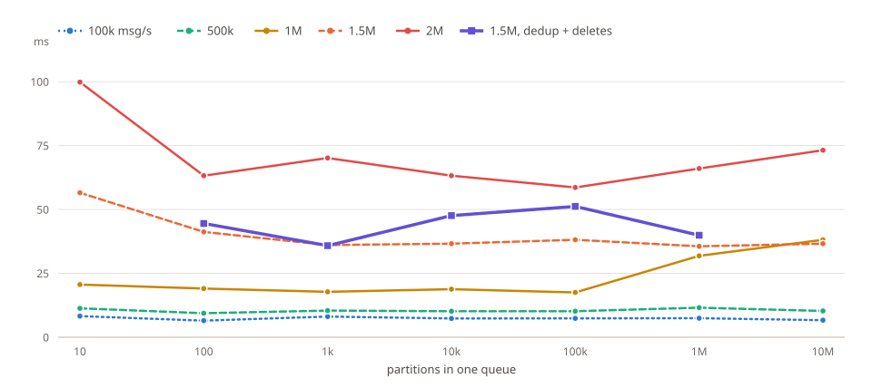

<div align="center">

<picture>
  <source media="(prefers-color-scheme: dark)" srcset="assets/logo/queen-tagline-on-dark.svg">
  
</picture>

**High-performance transactional message broker**

Queen MQ is a transactional event broker. When a worker handles an event, the ack, the state it
changes, the events it emits and the timer it sets commit as one entry of a replicated log, or not
at all. 

On three nodes it carries 1M msg/s in and out of one queue of 10M partitions.

Queen speaks HTTP but is also compatible with Kafka clients.

[Documentation](https://queenmq.com) · [Quickstart](https://queenmq.com/start/quickstart/) · [Benchmarks](https://queenmq.com/benchmarks/) · [MCP for agents](https://queenmq.com/start/ai-agents/) · [Try it free on Queen Cloud](https://queenmq.cloud) · Apache-2.0 · v2.3

</div>

---

## Why Queen

**One partition per entity.** Most brokers make you pick a partition count up front and hash your
keys onto it, so one slow customer blocks everyone who hashed next to it. In Queen every customer,
order or conversation gets its own ordered partition, created by the first push that names it. No
count to plan, no head-of-line blocking, and ten million partitions in one queue is a benchmark we
publish.

**One commit per step.** Handling an event usually spans four systems: a broker, a database with an
outbox, a scheduler and an idempotency table, and a crash between any two leaves the step half done.
In Queen it is one transaction: ack the event, push the next ones, write KV state and set timers,
all in one log entry.

**One binary.** No database, ZooKeeper or sidecar beside it. Tenants live in their own Raft groups,
each with its own leader, so a transaction needs no coordinator and no two-phase commit.

In production at [Smartness](https://www.smartness.com/en). Tested with Jepsen.

## Features

- **Partitions on demand.** Created by the first push that names them, ordered inside, cheap enough
  for millions. [Partitions](https://queenmq.com/concepts/partitions/)
- **Transactions.** Ack, push, KV and timers commit together or not at all, fenced by the worker's
  lease. [Transactions](https://queenmq.com/concepts/transactions/)
- **Exactly-once effects.** Push dedup by `transactionId`, and `once` to run a step at most once.
  [Dedup](https://queenmq.com/concepts/dedup/)
- **Consumer groups.** A cursor per group: fan-out, replay, seek by time, retries and a dead-letter
  queue. [Consuming](https://queenmq.com/concepts/consuming/)
- **State and time.** A transactional [KV](https://queenmq.com/concepts/kv/) with versions and an
  expiry on every write, [timers](https://queenmq.com/concepts/timers/) that fire real messages into
  real queues, delayed delivery, debounce windows, conflation.
- **Streams.** Tumbling, sliding, session and cron windows whose state commits with the ack.
  [Streams](https://queenmq.com/guides/streams/)
- **Ephemeral queues.** In memory, for request/reply, presence and live updates.
  [Ephemeral](https://queenmq.com/guides/ephemeral/)
- **Kafka, PostgreSQL, S3.** Kafka clients connect unchanged, PostgreSQL tables stream in and out,
  queues land in S3 as JSONL or Parquet, exactly once, with no connector process.
  [Kafka](https://queenmq.com/guides/kafka/) · [PostgreSQL](https://queenmq.com/guides/postgres/) · [S3](https://queenmq.com/guides/s3/)
- **Batteries included.** A dashboard on the same port, Prometheus metrics, JWT/JWKS auth, payload
  encryption, a multi-tenant proxy with API keys, Raft over three or five nodes.
- **Any client.** curl, six SDKs (JavaScript, Python, Go, Rust, C++, PHP with a Laravel driver) and
  `queenctl`. [Clients](https://queenmq.com/start/clients/)

## Benchmarks

Three 16-vCPU nodes, every write fsynced on two of them before the answer, with Kafka 4.3.1 on the
same machines (Redpanda 26.2.3 and Pulsar 4.2.4 were last run in September, beside Queen
2.0.0-beta.2). Each row links to the run and its conditions.

<picture>
  <source media="(prefers-color-scheme: dark)" srcset="assets/bench-partitions-p99-dark.svg">
  
</picture>

<sub>End to end p99, the worst load process in seconds 30-60 of 70. With deduplication and deletes after 60 s: the
last 60 s of 200, pooled; not carried at 10 and 10M partitions.</sub>

| | Result |
|---|---|
| [Partitions](https://queenmq.com/benchmarks/partitions/) | 1,000,000 msg/s in and out of one queue at every count from 10 to **10,000,000 partitions**, e2e p99 **18 to 38 ms**; 2,000,000 msg/s at 59 to 100 ms. At 2,000,000 msg/s Kafka reads 25 ms at 1,000 partitions, 134 ms at 10,000, and falls behind at 100,000. |
| [Throughput](https://queenmq.com/benchmarks/throughput/) | One queue of 100 partitions: e2e p50 / p99 of 10 / 19 ms at 1,000,000 msg/s and 31 / 63 ms at 2,000,000 (Kafka 8 / 11 and 8 / 43). Against 2.2.0 on the same machines: 27 / 85 ms to 12 / 18 ms at 1,000,000 msg/s. |
| [Transactions](https://queenmq.com/benchmarks/transactions/) | 10 messages per transaction: commit p99 **4 ms** at 6,000 transactions a second, a ceiling near 12,900 a second. In September's comparison: commit p99 4 ms against Kafka's 34 and Pulsar's 32. |
| [Kafka clients](https://queenmq.com/benchmarks/kafka-clients/) | franz-go at 1,000,000 msg/s through Queen's Kafka port, e2e p99 48 ms. |
| [Soak](https://queenmq.com/benchmarks/soak/) | 500,000 msg/s for 3 h 23 min over 1,000,000 partitions, through a kill -9 of the leader and of a follower: e2e p99 86 ms in the median window. |
| [Jepsen](https://queenmq.com/benchmarks/jepsen/) | **244 tests** on the code of 2.2.0: all valid, one of them at its second run, after the test harness had crashed in the first. No acknowledged message lost, no lease held twice, transactions atomic. |
| [Laravel](https://queenmq.com/benchmarks/laravel/) | 2,753 jobs/s with 32 workers on one node, against 1,124 for Horizon on Redis. |

Where Queen is behind: with few partitions Kafka is faster and carries more (4M msg/s at p99
243 ms, while one Queen queue stops between 2M and 2.5M, set by its leader) and spends less CPU per
message. The 2.3.0 figures are pre-release builds with the binary wire forms a client turns on.
[Method and rig](https://queenmq.com/benchmarks/methodology/).

## Quick start

```bash
docker run -d -p 6632:6632 ghcr.io/queen-mq/queen:latest
```

```bash
curl -X POST http://localhost:6632/api/v1/push -H 'content-type: application/json' -d '{
  "items": [{ "queue": "orders", "partition": "customer-123",
              "transactionId": "order-8891-created",
              "payload": { "orderId": 8891 } }]
}'
```

`transactionId` is your idempotency key: a retry of the same push writes nothing the second time.
Open http://localhost:6632 for the dashboard, and take the
[Quickstart](https://queenmq.com/start/quickstart/) from there.

Building with a coding agent? Connect it to Queen's MCP server: it teaches the agent the 2.0 model
and hands it tested code, the known traps and what each error means. No sign-in, and it never sees
your code.

```bash
claude mcp add --transport http queen https://queenmq.com/mcp
```

Cursor, VS Code, Codex and Claude Desktop: [AI agents](https://queenmq.com/start/ai-agents/).

## Documentation

- [The model](https://queenmq.com/concepts/): partitions, consumer groups, transactions, KV, timers, dedup, guarantees.
- [Guides](https://queenmq.com/guides/) · [Examples](https://queenmq.com/examples/): exactly-once, state machines, streams, webhooks, Kafka, PostgreSQL, S3, Laravel.
- [Operate](https://queenmq.com/operate/): a [cluster](https://queenmq.com/operate/cluster/), [Kubernetes](https://queenmq.com/operate/kubernetes/), [monitoring](https://queenmq.com/operate/monitoring/), [recovery](https://queenmq.com/operate/recovery/), [tenants](https://queenmq.com/operate/tenants/).
- [Reference](https://queenmq.com/reference/): the HTTP API, configuration, errors, limits.
- [Internals](https://queenmq.com/internals/): the replicated log, storage, the life of a step.
- [Compared to Kafka, SQS and Temporal](https://queenmq.com/start/compare/).

## Contributing

See [CONTRIBUTING.md](CONTRIBUTING.md) and the
[contributing guide](https://queenmq.com/internals/contributing/). Benchmark claims need an archived
artifact under `benchmark-queen/`, and doc pages name the source files they describe.

## Built on

Queen stands on open-source work. Thank you to the maintainers of:

- [openraft](https://github.com/databendlabs/openraft): the raft consensus that replicates the log
- [heed](https://github.com/meilisearch/heed): LMDB storage for the raft log
- [tokio](https://tokio.rs) and [axum](https://github.com/tokio-rs/axum): the async runtime and HTTP
- [Jepsen](https://jepsen.io): the fault-injection tests the broker runs against

## License

Apache-2.0, see [LICENSE.md](LICENSE.md). The broker and the proxy both, so the multi-tenant service
is yours to run.

---

Queen MQ is built at [Smartness](https://www.smartness.com/en).
